# Claude Critter

A tiny, tokenless desktop pet that lives in the **Claude desktop app** on Windows. It walks on the UI, reacts to everything Claude and you do, and never costs a single token.

[](https://www.youtube.com/watch?v=amQ88J_k5Ko)

▶ **[Watch the video on YouTube](https://www.youtube.com/watch?v=amQ88J_k5Ko)**

## What it does

- **Works along with Claude.** It grabs a book while Claude reads, a magnifier while it searches, a pencil while it edits and a little CPU while commands run.
- **Waits with you.** When Claude asks for permission it holds up a sign and cheers when you allow it.
- **Celebrates.** It dances when tests pass and throws confetti on commits.
- **Has coworkers.** Every subagent shows up as a small critter that walks in and leaves when its task is done.
- **Lives on the UI like in a platformer.** Messages, code blocks and the prompt box are platforms. When a platform moves, things fall.
- **Plays.** Pet it (not too much), grab and throw it, play fetch with the ball, watch it portal onto a code block or crash through the sidebar wall.
- **Builds things.** Flags, flowers and block towers. Click them to smash them (it will sulk).
- **Has a mind of its own.** When nothing happens it picks its own idle activities and avoids repeating itself. It naps when you are away.

## Privacy and cost

- **Zero tokens.** The plugin never calls a model.
- **No screenshots.** The overlay reads the Claude window through Windows UI Automation (element positions, the prompt text for typing reactions). Nothing leaves your computer.
- It only shows while the Claude window is in front and hides when you minimize it.

## Requirements

- Windows 10 or 11
- The Claude desktop app with Claude Code
- Python 3.10+ with the `comtypes` package (the installer sets this up)

## Install

One line in PowerShell:

```powershell
irm https://raw.githubusercontent.com/Kessler833/claude-critter/main/install.ps1 | iex
```

Or by hand:

```powershell
python -m pip install --user comtypes
claude plugin marketplace add Kessler833/claude-critter
claude plugin install critter@claude-critter
```

Then restart the Claude desktop app.

## Use

- The critter appears on its own when a session starts. Type `/critter` to bring it back after you quit it.
- **Right-click** the critter for: sleep / wake up, dance, play ball, send mini agents away, size, eye style, quit.
- Drag it, throw it, wiggle the mouse over it to pet it, double-click to make it jump.

## How it works

- `hooks/register.tsx` is a Claude Code plugin. It writes a small status file (`~/.claude/critter/state.json`) with what Claude is doing: thinking, which tool, permission requests, test results, commits, subagents.
- `overlay/critter.pyw` is the pet: a borderless, transparent tkinter window per object. It reads that status file and the Claude window layout via UI Automation and runs at 30 fps with about 0.5 % CPU.

## Uninstall

```powershell
claude plugin uninstall critter@claude-critter
claude plugin marketplace remove claude-critter
```

## Known limitations

- Windows only.
- Some UI reactions (sidebar status rows, standing on messages) match the Claude app's UI labels and are currently tuned for the German app language. With other languages the critter still works, but uses fewer platforms.

## Gallery

| | | | | |
|---|---|---|---|---|
| 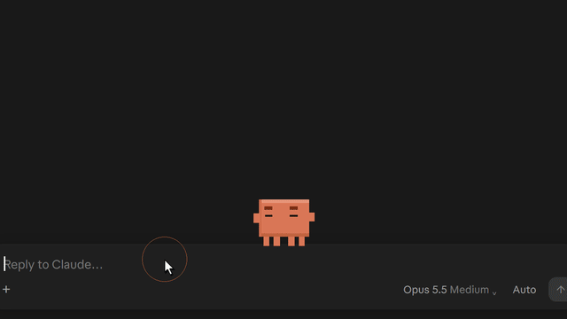<br><sub>Follows your typing</sub> | 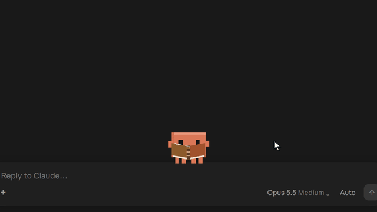<br><sub>Reads along</sub> | 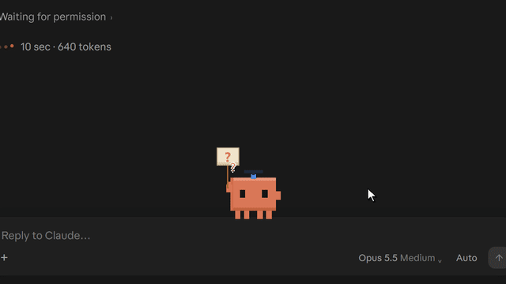<br><sub>Waits for your OK</sub> | 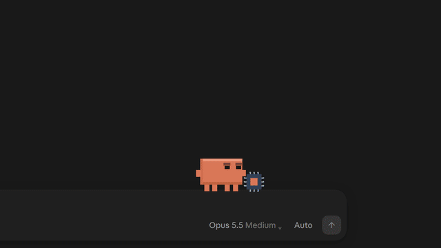<br><sub>Celebrates tests</sub> | 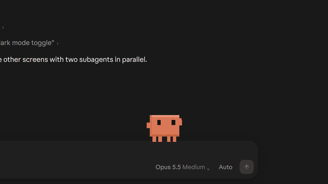<br><sub>Subagents walk in</sub> |
| 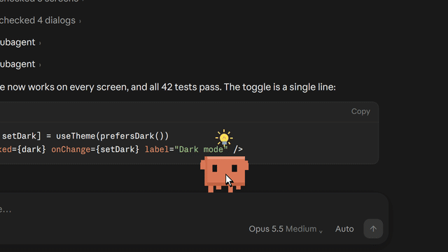<br><sub>Loves pets. Mostly.</sub> | 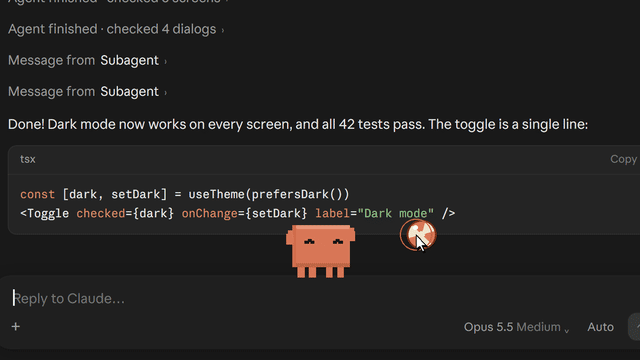<br><sub>Plays fetch</sub> | 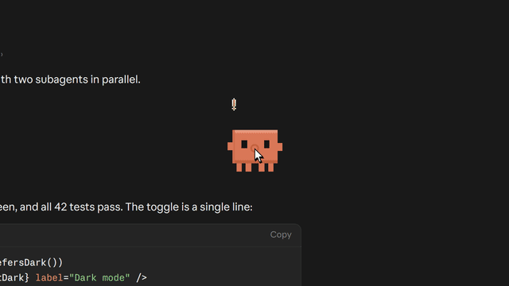<br><sub>Grab and throw</sub> | 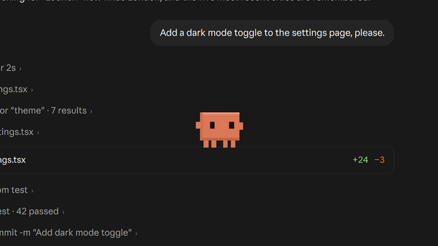<br><sub>Portals onto code</sub> | 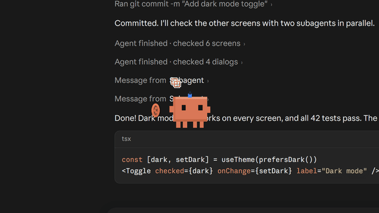<br><sub>Crashes through walls</sub> |
| 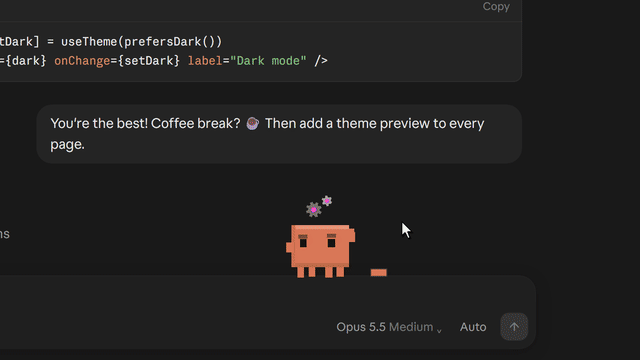<br><sub>Hyperfocus mode</sub> | 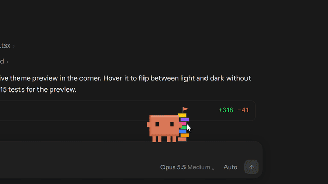<br><sub>Sulks when you smash his tower</sub> | 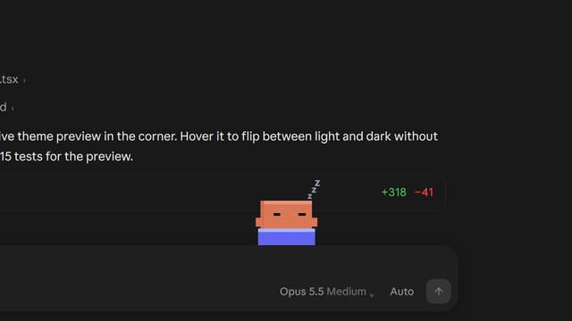<br><sub>Naps</sub> |  |  |

## License

[MIT](LICENSE) © Hannes Kapsch
